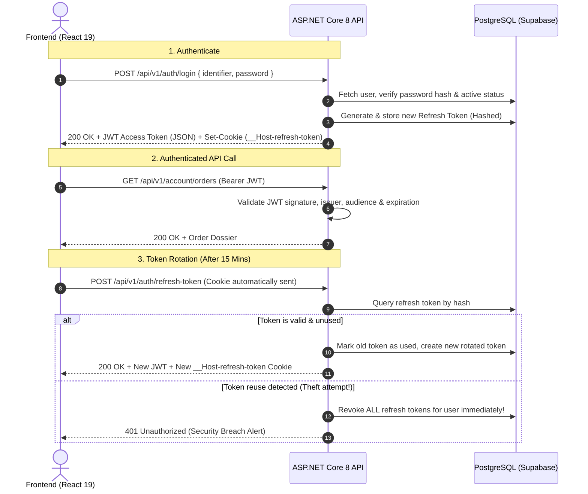

# MAISON VÉRA — Authentication & Security Architecture
**Enterprise Security Specification, JWT Lifecycle & RBAC Authorization Matrix**
*Document Version: 1.0.0 | Date: 2026-11-21 | Target Framework: ASP.NET Core 8 & PostgreSQL*

---

## 1. Identity Architecture & User Model

### 1.1 Custom Identity with ASP.NET Core Primitives
Rather than adopting heavyweight, default ASP.NET Core Identity with its predefined table structures and UI assumptions, MAISON VÉRA implements a clean, tailored identity system utilizing ASP.NET Core's core security abstractions (`IPasswordHasher<T>`, `IAuthenticationService`, `IAuthorizationHandler`) over a unified EF Core model:

- **Unified Identity Table (`users`):** All human actors—whether luxury private clients, boutique fulfillment staff, customer care associates, or atelier directors—are modeled within a single relational table.
- **Discriminator & Roles:** Actors are classified via `user_type` (`Customer`, `Staff`, `Admin`) and linked via `user_roles` to defined system roles (`roles`), each carrying granular module permissions (`role_claims`).

### 1.2 Password Hashing & Key Derivation
- **Algorithm:** **Argon2id** (via `Konscious.Security.Cryptography.Argon2` or ASP.NET Core PBKDF2-HMAC-SHA256 fallback).
- **Argon2id Parameters:**
  - Memory Cost: `65,536 KB` (64 MB)
  - Iteration Count: `4`
  - Degree of Parallelism: `2`
  - Salt: Cryptographically secure 128-bit pseudo-random salt generated via `RandomNumberGenerator.GetBytes(16)`.
- **PBKDF2 Fallback:**
  - HMAC: `HMACSHA256`
  - Iteration Count: `100,000`
  - Salt: 128-bit random salt
- **Password Strength Policy:**
  - Minimum 8 characters, maximum 128 characters.
  - At least one uppercase letter (`[A-Z]`).
  - At least one lowercase letter (`[a-z]`).
  - At least one digit (`[0-9]`).
  - At least one special symbol (`[!@#$%^&*()_+\-=\[\]{}|;:,.<>?]`).

---

## 2. JWT Access Token & Refresh Token Rotation



### 2.1 JWT Access Token Structure
- **Format:** Cryptographically signed JSON Web Token (RFC 7519).
- **Signing Algorithm:** `HMAC-SHA256` (HS256) with a minimum 512-bit key, or `RS256` (Asymmetric RSA-2048) with private key on server and public key exposed via standard JWKS.
- **Lifetime:** **15 minutes** (900 seconds) to strictly limit window of exposure.
- **Standard Claims:**
  - `sub`: User ID (`UUID`)
  - `email`: Normalized Email Address
  - `name`: Full Name
  - `user_type`: `Customer` | `Staff` | `Admin`
  - `role`: Assigned Role Name (e.g. `Super Admin`, `Order Manager`)
  - `jti`: Unique Token Identifier (`UUID`) to prevent replay
  - `iat`: Issued At Unix timestamp
  - `exp`: Expiration Unix timestamp

### 2.2 Refresh Token Architecture
- **Generation:** 64 cryptographically secure random bytes generated via `RandomNumberGenerator.GetBytes(64)`, Base64URL-encoded.
- **Storage:** Only the SHA-256 hash of the refresh token is stored in the PostgreSQL `refresh_tokens` table. Even if the database is compromised, plaintext refresh tokens cannot be harvested.
- **Lifetime:** **7 days** (604,800 seconds).
- **Client Storage Mechanism:** Strictly stored in a cookie with hardened security flags:
  - Name: `__Host-refresh-token` (requires `Secure`, `Path=/`, no subdomain)
  - `HttpOnly`: `true` (Inaccessible to client-side JavaScript, neutralizing XSS theft)
  - `Secure`: `true` (Transmitted strictly over TLS/HTTPS)
  - `SameSite`: `Strict` (Neutralizes Cross-Site Request Forgery)
  - `Path`: `/api/v1/auth` (Cookie sent only to auth endpoints)
- **Automatic Rotation:** Every invocation of `/api/v1/auth/refresh-token` invalidates the submitted token and issues a brand-new token pair.
- **Reuse Detection (Theft Countermeasure):** If an incoming request presents a refresh token that has already been marked `is_used = true`, the system assumes a token theft incident has occurred:
  1. The API immediately revokes **all** active refresh tokens belonging to that `user_id`.
  2. An emergency security audit log entry is recorded (`SECURITY_BREACH_REFRESH_TOKEN_REUSE`).
  3. The response returns `401 Unauthorized`, forcing re-authentication across all active devices.

---

## 3. Role-Based Access Control (RBAC) & Permission Engine

### 3.1 Role Hierarchy & Module Permissions Matrix
The system enforces 7 distinct operational roles:
1. **Super Admin:** Complete, irrevocable system authority across all modules, finances, staff provisioning, and audit logs.
2. **Admin:** Full operational authority across catalog, orders, payments, customers, and marketing. Cannot delete Super Admins or modify core brand legal ownership.
3. **Order Manager:** Dedicated to order lifecycle, dispatch, shipping coordination, and status advancement.
4. **Product Manager:** Manages garments, categories, collections, and inventory stock counts.
5. **Payment Manager:** Reviews digital wallet payment proof screenshots, verifies transactions, or issues rejections.
6. **Customer Support:** Read-only access to orders, customers, and reviews; can add internal support notes and moderate reviews.
7. **Customer:** Access restricted strictly to own profile, orders, addresses, wishlist, and public catalog.

| Operational Module | Super Admin | Admin | Order Manager | Product Manager | Payment Manager | Customer Support | Customer |
|---|---|---|---|---|---|---|---|
| **Catalog (Products)** | View, Create, Edit, Delete | View, Create, Edit, Delete | View | View, Create, Edit, Delete | View | View | View Public |
| **Categories & Capsules**| View, Create, Edit, Delete | View, Create, Edit, Delete | View | View, Create, Edit, Delete | View | View | View Public |
| **Inventory & Stock** | View, Adjust, Log | View, Adjust, Log | View | View, Adjust, Log | None | None | None |
| **Orders & Fulfillment**| Full Authority | Full Authority | View, Update Status, Note | View | View | View, Note | Own Orders Only |
| **Payment Verification**| Full Authority | Full Authority | View | None | View, Verify, Reject | None | Own Payments |
| **Customer Dossiers** | View, Suspend, Edit | View, Suspend | View | None | None | View, Add Note | Own Profile Only |
| **Staff & Roles** | Full Authority | None | None | None | None | None | None |
| **Marketing (Coupons/Banners)** | Full Authority | Full Authority | View | View | None | None | Public Banners |
| **Reviews Moderation** | Full Authority | Full Authority | View | View | None | View, Approve, Reject | Submit Own |
| **System Settings** | Full Authority | Brand Settings Only | None | None | Payment Gateways Only | None | View Public |
| **Audit Logs** | Read All | None | None | None | None | None | None |

### 3.2 ASP.NET Core Policy-Based Implementation
Authorization is evaluated using ASP.NET Core 8 Custom Authorization Policies rather than hardcoded role strings:
```csharp
builder.Services.AddAuthorization(options =>
{
    options.AddPolicy("RequireSuperAdmin", policy => 
        policy.RequireRole("Super Admin"));

    options.AddPolicy("CanManageCatalog", policy => 
        policy.RequireRole("Super Admin", "Admin", "Product Manager"));

    options.AddPolicy("CanManageOrders", policy => 
        policy.RequireRole("Super Admin", "Admin", "Order Manager"));

    options.AddPolicy("CanVerifyPayments", policy => 
        policy.RequireRole("Super Admin", "Admin", "Payment Manager"));

    options.AddPolicy("CustomerOnly", policy => 
        policy.RequireRole("Customer"));
});
```
Endpoint controllers utilize declarative attributes:
```csharp
[Authorize(Policy = "CanVerifyPayments")]
[HttpPost("{orderId}/verify")]
public async Task<IActionResult> VerifyPayment(Guid orderId) { ... }
```

---

## 4. Hardened Security Countermeasures

### 4.1 Rate Limiting Architecture (ASP.NET Core 8 RateLimiter)
To defend against brute-force password cracking, credential stuffing, and Denial of Service (DoS):
1. **Global IP Limiter:** Fixed window of `100 requests / minute` per client IP.
2. **Auth Endpoint Limiter (Strict):** Sliding window of `5 login attempts / minute` per client IP or email. Exceeding triggers HTTP `429 Too Many Requests` with `Retry-After: 60`.
3. **Checkout Limiter:** `10 order placement attempts / hour` per IP/account to prevent inventory exhaustion attacks.
4. **Media Upload Limiter:** `15 uploads / minute` per authenticated user.

### 4.2 Cross-Origin Resource Sharing (CORS) Policy
- **Wildcard Prohibition:** `AllowAnyOrigin()` (`*`) is strictly forbidden.
- **Explicit Origin Whitelist:**
  - Local Dev: `http://localhost:5173`, `http://localhost:3000`
  - Production: `https://maisonvera.com`, `https://www.maisonvera.com`, `https://krishna2062.github.io`
- **Credentials Support:** `.AllowCredentials()` enabled strictly for whitelisted origins to permit transmission of `__Host-refresh-token` cookies.
- **Allowed Headers:** `Authorization`, `Content-Type`, `X-Requested-With`, `X-CSRF-TOKEN`.

### 4.3 SQL Injection & ORM Safety
- All data interactions are executed through **Entity Framework Core 8** compiled expression trees, ensuring 100% parameterized SQL query emission by `Npgsql`.
- Raw string interpolation into SQL queries (e.g. `FromSqlRaw($"SELECT * FROM users WHERE email = '{email}'")`) is strictly prohibited. If raw SQL is required for reporting, `FromSqlInterpolated` with automatic DB parameter wrapping is mandated.

### 4.4 Cross-Site Scripting (XSS) & Content Security
- All user inputs (names, addresses, comments, review text, internal notes) are sanitized on ingress using `Ganss.Xss.HtmlSanitizer`.
- React automatically escapes rendered strings in the DOM.
- Security Headers Middleware emits:
  - `Content-Security-Policy: default-src 'self'; img-src 'self' data: https:; script-src 'self'; style-src 'self' 'unsafe-inline' https://fonts.googleapis.com; font-src 'self' https://fonts.gstatic.com;`
  - `X-Content-Type-Options: nosniff`
  - `X-Frame-Options: DENY`
  - `Referrer-Policy: strict-origin-when-cross-origin`
  - `Strict-Transport-Security: max-age=31536000; includeSubDomains; preload`

### 4.5 File Upload Security (Payment Receipts & Garment Imagery)
Uploading user files introduces severe attack vectors (e.g., webshell execution, binary malware). The upload pipeline enforces:
1. **MIME-Type & Magic Byte Validation:** File extensions are cross-verified against their binary magic bytes (e.g., JPEG: `FF D8 FF`, PNG: `89 50 4E 47`, WebP: `52 49 46 46`). Executable binaries or scripts are immediately rejected.
2. **File Size Capping:** Strict max limit of `5 MB` for payment receipts; `10 MB` for high-res lookbook photography.
3. **Randomized Renaming:** Incoming filenames are completely discarded. Files are renamed to random GUIDs (`uuid-v4.webp`) to prevent path traversal (`../`) and remote execution.
4. **Storage Segregation:**
   - **Public Lookbook Imagery:** Stored in a public Supabase Storage bucket with CDN caching.
   - **Payment Proof Receipts:** Stored in a **private, non-public** Supabase Storage bucket. Access requires an authenticated staff member requesting a temporary pre-signed URL with a 5-minute expiry.

### 4.6 Secrets Management
- **Development:** Zero hardcoded API keys or database passwords. Managed locally via .NET Secret Manager (`dotnet user-secrets`).
- **Production:** Injected via secure environment variables in Azure App Service / Railway / Render hosting environments and Supabase Secret Vault.
