# MAISON VÉRA — Database Architecture & Relational Schema Design
**Supabase PostgreSQL & Entity Framework Core 8 Code-First Specification**
*Document Version: 1.0.0 | Date: 2026-11-21 | Target Database: PostgreSQL 16 on Supabase*

---

## 1. Architectural Principles & Standards

### 1.1 PostgreSQL 16 & EF Core 8 Standards
1. **Primary Key Strategy:** Universal use of UUIDv7 or standard UUID (`uuid_generate_v4()` / EF Core `Guid.NewGuid()`) for distributed safety, predictability, and prevention of enumeration attacks.
2. **Temporal Standard:** All timestamps stored with explicit timezone offsets using PostgreSQL `TIMESTAMPTZ` (EF Core `DateTimeOffset` in UTC). No local time representations exist at the database tier.
3. **Monetary & Financial Precision:** All monetary amounts, prices, sub-totals, tariffs, discounts, and order balances are strictly typed as `NUMERIC(18,2)` (`decimal(18,2)` in C#). Floating-point (`REAL`, `FLOAT`, `DOUBLE`) representations are forbidden.
4. **Soft Delete Standard:** Critical business entities (`users`, `products`, `categories`, `collections`, `orders`, `coupons`) implement temporal soft deletion:
   - `is_deleted`: `BOOLEAN NOT NULL DEFAULT FALSE`
   - `deleted_at`: `TIMESTAMPTZ NULL`
   - `deleted_by`: `UUID NULL` (FK to `users.id`)
   EF Core Global Query Filters will automatically filter `!e.IsDeleted` on all query sets unless explicitly overridden with `.IgnoreQueryFilters()`.
5. **Auditing Standard:** Every entity inherits standard audit columns:
   - `created_at`: `TIMESTAMPTZ NOT NULL DEFAULT NOW()`
   - `updated_at`: `TIMESTAMPTZ NOT NULL DEFAULT NOW()`
   - `created_by`: `UUID NULL` (FK to `users.id`)
   - `updated_by`: `UUID NULL` (FK to `users.id`)
6. **Order Snapshot Principle:** To ensure legal and financial immutability, orders never reference mutable product descriptions, live customer profiles, or active delivery tariff records. The `order_items` and `orders` tables store frozen immutable snapshots of item names, product slugs, SKUs, sizes, colors, unit prices, applied coupons, delivery tariffs, and the complete physical shipping address as it existed at the instant of order placement.
7. **Concurrency Control:** Critical transactional records (`orders`, `product_variants`, `brand_settings`) feature an `xmin` PostgreSQL system column or `concurrency_token` (`UUID`) for optimistic locking to prevent double-spending or overselling.

---

## 2. Entity-Relationship Diagram (Mermaid)

```mermaid
erDiagram
    users ||--o{ refresh_tokens : "owns"
    users ||--o| customer_profiles : "has"
    users ||--o| staff_profiles : "has"
    users ||--o{ customer_addresses : "maintains"
    users ||--o{ orders : "places"
    users ||--o{ cart_items : "stores"
    users ||--o{ wishlist_items : "saves"
    users ||--o{ product_reviews : "writes"
    users ||--o{ notifications : "receives"
    users ||--o{ audit_logs : "triggers"
    users ||--o{ user_roles : "assigned"
    roles ||--o{ user_roles : "contains"
    roles ||--o{ role_claims : "defines"

    categories ||--o{ products : "categorizes"
    collections ||--o{ collection_products : "contains"
    products ||--o{ collection_products : "belongs_to"
    products ||--o{ product_images : "showcases"
    products ||--o{ product_sizes : "offers"
    products ||--o{ product_colors : "offers"
    products ||--o{ product_variants : "instantiates"
    products ||--o{ product_reviews : "receives"
    products ||--o{ wishlist_items : "saved_in"
    products ||--o{ cart_items : "added_to"

    product_variants ||--o{ stock_movements : "tracks"
    product_variants ||--o{ cart_items : "references"
    product_variants ||--o{ order_items : "referenced_by"

    coupons ||--o{ orders : "discounts"
    delivery_zones ||--o{ orders : "prices_shipping"

    orders ||--|{ order_items : "contains"
    orders ||--|{ order_timeline_events : "progresses_through"
    orders ||--o{ payment_transactions : "audits"
```



---

## 3. Comprehensive Database Schema Definition (28 Tables)

### 3.1 Identity, Users & Access Control

#### Table 1: `users`
Core identity table representing all system actors (customers, staff, administrators).
```sql
CREATE TABLE users (
    id UUID PRIMARY KEY DEFAULT gen_random_uuid(),
    email VARCHAR(256) NOT NULL UNIQUE,
    normalized_email VARCHAR(256) NOT NULL UNIQUE,
    phone_number VARCHAR(32) NOT NULL UNIQUE,
    password_hash VARCHAR(1024) NOT NULL,
    security_stamp VARCHAR(256) NOT NULL DEFAULT gen_random_uuid()::text,
    concurrency_stamp VARCHAR(256) NOT NULL DEFAULT gen_random_uuid()::text,
    user_type VARCHAR(32) NOT NULL CHECK (user_type IN ('Customer', 'Staff', 'Admin')),
    is_active BOOLEAN NOT NULL DEFAULT TRUE,
    email_confirmed BOOLEAN NOT NULL DEFAULT FALSE,
    phone_confirmed BOOLEAN NOT NULL DEFAULT FALSE,
    two_factor_enabled BOOLEAN NOT NULL DEFAULT FALSE,
    lockout_end TIMESTAMPTZ NULL,
    lockout_enabled BOOLEAN NOT NULL DEFAULT TRUE,
    access_failed_count INT NOT NULL DEFAULT 0,
    created_at TIMESTAMPTZ NOT NULL DEFAULT NOW(),
    updated_at TIMESTAMPTZ NOT NULL DEFAULT NOW(),
    last_login_at TIMESTAMPTZ NULL,
    is_deleted BOOLEAN NOT NULL DEFAULT FALSE,
    deleted_at TIMESTAMPTZ NULL,
    deleted_by UUID NULL REFERENCES users(id)
);

CREATE INDEX idx_users_email ON users(normalized_email);
CREATE INDEX idx_users_phone ON users(phone_number);
CREATE INDEX idx_users_user_type ON users(user_type);
```

#### Table 2: `roles`
System authorization roles.
```sql
CREATE TABLE roles (
    id UUID PRIMARY KEY DEFAULT gen_random_uuid(),
    name VARCHAR(64) NOT NULL UNIQUE,
    normalized_name VARCHAR(64) NOT NULL UNIQUE,
    description VARCHAR(256) NOT NULL,
    is_system_role BOOLEAN NOT NULL DEFAULT FALSE,
    created_at TIMESTAMPTZ NOT NULL DEFAULT NOW(),
    updated_at TIMESTAMPTZ NOT NULL DEFAULT NOW()
);

-- Seed Initial Roles:
-- Super Admin, Admin, Order Manager, Product Manager, Payment Manager, Customer Support, Customer
```

#### Table 3: `role_claims`
Fine-grained module permission matrix per role.
```sql
CREATE TABLE role_claims (
    id UUID PRIMARY KEY DEFAULT gen_random_uuid(),
    role_id UUID NOT NULL REFERENCES roles(id) ON DELETE CASCADE,
    module VARCHAR(64) NOT NULL, -- e.g., 'Catalog', 'Orders', 'Payments', 'Customers', 'Staff', 'Marketing', 'Settings'
    can_view BOOLEAN NOT NULL DEFAULT FALSE,
    can_create BOOLEAN NOT NULL DEFAULT FALSE,
    can_edit BOOLEAN NOT NULL DEFAULT FALSE,
    can_delete BOOLEAN NOT NULL DEFAULT FALSE,
    created_at TIMESTAMPTZ NOT NULL DEFAULT NOW(),
    updated_at TIMESTAMPTZ NOT NULL DEFAULT NOW(),
    CONSTRAINT uq_role_module UNIQUE(role_id, module)
);
```

#### Table 4: `user_roles`
User-to-role assignment junction.
```sql
CREATE TABLE user_roles (
    user_id UUID NOT NULL REFERENCES users(id) ON DELETE CASCADE,
    role_id UUID NOT NULL REFERENCES roles(id) ON DELETE CASCADE,
    assigned_at TIMESTAMPTZ NOT NULL DEFAULT NOW(),
    assigned_by UUID NULL REFERENCES users(id),
    PRIMARY KEY (user_id, role_id)
);
```

#### Table 5: `refresh_tokens`
Cryptographically secure refresh tokens with rotation and reuse tracking.
```sql
CREATE TABLE refresh_tokens (
    id UUID PRIMARY KEY DEFAULT gen_random_uuid(),
    user_id UUID NOT NULL REFERENCES users(id) ON DELETE CASCADE,
    token_hash VARCHAR(256) NOT NULL UNIQUE,
    jwt_id VARCHAR(128) NOT NULL, -- JTI of associated access token
    expires_at TIMESTAMPTZ NOT NULL,
    created_at TIMESTAMPTZ NOT NULL DEFAULT NOW(),
    created_by_ip VARCHAR(64) NOT NULL,
    is_revoked BOOLEAN NOT NULL DEFAULT FALSE,
    revoked_at TIMESTAMPTZ NULL,
    revoked_by_ip VARCHAR(64) NULL,
    replaced_by_token_hash VARCHAR(256) NULL,
    is_used BOOLEAN NOT NULL DEFAULT FALSE
);

CREATE INDEX idx_refresh_tokens_hash ON refresh_tokens(token_hash);
CREATE INDEX idx_refresh_tokens_user ON refresh_tokens(user_id);
```

---

### 3.2 Customer & Staff Profiles

#### Table 6: `customer_profiles`
Dedicated customer information and spending metrics.
```sql
CREATE TABLE customer_profiles (
    user_id UUID PRIMARY KEY REFERENCES users(id) ON DELETE CASCADE,
    full_name VARCHAR(128) NOT NULL,
    avatar_url VARCHAR(512) NULL,
    joined_date TIMESTAMPTZ NOT NULL DEFAULT NOW(),
    total_orders INT NOT NULL DEFAULT 0,
    total_spent NUMERIC(18,2) NOT NULL DEFAULT 0.00,
    vip_tier VARCHAR(32) NOT NULL DEFAULT 'Standard' CHECK (vip_tier IN ('Standard', 'Silver', 'Gold', 'Private Atelier')),
    internal_notes TEXT NULL,
    updated_at TIMESTAMPTZ NOT NULL DEFAULT NOW()
);
```

#### Table 7: `customer_addresses`
Nepal-specific address book for clients.
```sql
CREATE TABLE customer_addresses (
    id UUID PRIMARY KEY DEFAULT gen_random_uuid(),
    user_id UUID NOT NULL REFERENCES users(id) ON DELETE CASCADE,
    label VARCHAR(32) NOT NULL DEFAULT 'Home', -- 'Home', 'Office', 'Atelier'
    full_name VARCHAR(128) NOT NULL,
    phone_number VARCHAR(32) NOT NULL,
    province VARCHAR(64) NOT NULL,
    district VARCHAR(64) NOT NULL,
    municipality VARCHAR(128) NOT NULL,
    ward VARCHAR(16) NOT NULL,
    street VARCHAR(256) NOT NULL,
    landmark VARCHAR(256) NOT NULL,
    special_instructions VARCHAR(512) NULL,
    is_default BOOLEAN NOT NULL DEFAULT FALSE,
    created_at TIMESTAMPTZ NOT NULL DEFAULT NOW(),
    updated_at TIMESTAMPTZ NOT NULL DEFAULT NOW()
);

CREATE INDEX idx_customer_addresses_user ON customer_addresses(user_id);
```

#### Table 8: `staff_profiles`
Staff metadata, department, and activity logging.
```sql
CREATE TABLE staff_profiles (
    user_id UUID PRIMARY KEY REFERENCES users(id) ON DELETE CASCADE,
    full_name VARCHAR(128) NOT NULL,
    employee_code VARCHAR(32) NOT NULL UNIQUE,
    department VARCHAR(64) NOT NULL DEFAULT 'Operations',
    last_active_at TIMESTAMPTZ NULL,
    updated_at TIMESTAMPTZ NOT NULL DEFAULT NOW()
);
```

---

### 3.3 Catalog: Categories, Collections, Products & Variants

#### Table 9: `categories`
Hierarchical product categories.
```sql
CREATE TABLE categories (
    id UUID PRIMARY KEY DEFAULT gen_random_uuid(),
    name VARCHAR(128) NOT NULL,
    slug VARCHAR(128) NOT NULL UNIQUE,
    description TEXT NULL,
    image_url VARCHAR(512) NOT NULL,
    parent_category_id UUID NULL REFERENCES categories(id) ON DELETE SET NULL,
    sort_order INT NOT NULL DEFAULT 0,
    status VARCHAR(32) NOT NULL DEFAULT 'Active' CHECK (status IN ('Active', 'Inactive')),
    created_at TIMESTAMPTZ NOT NULL DEFAULT NOW(),
    updated_at TIMESTAMPTZ NOT NULL DEFAULT NOW(),
    is_deleted BOOLEAN NOT NULL DEFAULT FALSE,
    deleted_at TIMESTAMPTZ NULL,
    deleted_by UUID NULL REFERENCES users(id)
);

CREATE INDEX idx_categories_slug ON categories(slug);
```

#### Table 10: `collections`
Curated editorial capsules and lookbooks.
```sql
CREATE TABLE collections (
    id UUID PRIMARY KEY DEFAULT gen_random_uuid(),
    name VARCHAR(128) NOT NULL,
    slug VARCHAR(128) NOT NULL UNIQUE,
    subtitle VARCHAR(256) NOT NULL,
    description TEXT NOT NULL,
    banner_image_url VARCHAR(512) NOT NULL,
    featured BOOLEAN NOT NULL DEFAULT FALSE,
    sort_order INT NOT NULL DEFAULT 0,
    status VARCHAR(32) NOT NULL DEFAULT 'Active' CHECK (status IN ('Active', 'Draft')),
    created_at TIMESTAMPTZ NOT NULL DEFAULT NOW(),
    updated_at TIMESTAMPTZ NOT NULL DEFAULT NOW(),
    is_deleted BOOLEAN NOT NULL DEFAULT FALSE,
    deleted_at TIMESTAMPTZ NULL,
    deleted_by UUID NULL REFERENCES users(id)
);

CREATE INDEX idx_collections_slug ON collections(slug);
```

#### Table 11: `collection_products`
Junction mapping products to collections with custom sorting.
```sql
CREATE TABLE collection_products (
    collection_id UUID NOT NULL REFERENCES collections(id) ON DELETE CASCADE,
    product_id UUID NOT NULL REFERENCES products(id) ON DELETE CASCADE,
    display_order INT NOT NULL DEFAULT 0,
    PRIMARY KEY (collection_id, product_id)
);
```

#### Table 12: `products`
The core luxury fashion garment master record.
```sql
CREATE TABLE products (
    id UUID PRIMARY KEY DEFAULT gen_random_uuid(),
    slug VARCHAR(256) NOT NULL UNIQUE,
    sku VARCHAR(64) NOT NULL UNIQUE,
    name VARCHAR(256) NOT NULL,
    description TEXT NOT NULL,
    materials_and_care JSONB NOT NULL DEFAULT '[]'::jsonb, -- Array of strings
    shipping_info TEXT NOT NULL,
    category_id UUID NOT NULL REFERENCES categories(id) ON DELETE RESTRICT,
    gender_collection VARCHAR(32) NOT NULL CHECK (gender_collection IN ('Men', 'Women', 'Unisex')),
    collection_tag VARCHAR(128) NULL,
    original_price NUMERIC(18,2) NOT NULL,
    selling_price NUMERIC(18,2) NOT NULL,
    discount_percent NUMERIC(5,2) NOT NULL DEFAULT 0.00,
    main_image_url VARCHAR(512) NOT NULL,
    featured BOOLEAN NOT NULL DEFAULT FALSE,
    new_arrival BOOLEAN NOT NULL DEFAULT FALSE,
    best_seller BOOLEAN NOT NULL DEFAULT FALSE,
    on_sale BOOLEAN NOT NULL DEFAULT FALSE,
    status VARCHAR(32) NOT NULL DEFAULT 'Published' CHECK (status IN ('Published', 'Draft', 'Archived')),
    total_stock INT NOT NULL DEFAULT 0,
    concurrency_token UUID NOT NULL DEFAULT gen_random_uuid(),
    created_at TIMESTAMPTZ NOT NULL DEFAULT NOW(),
    updated_at TIMESTAMPTZ NOT NULL DEFAULT NOW(),
    created_by UUID NULL REFERENCES users(id),
    updated_by UUID NULL REFERENCES users(id),
    is_deleted BOOLEAN NOT NULL DEFAULT FALSE,
    deleted_at TIMESTAMPTZ NULL,
    deleted_by UUID NULL REFERENCES users(id),
    CONSTRAINT chk_product_prices CHECK (selling_price >= 0 AND original_price >= selling_price)
);

CREATE INDEX idx_products_slug ON products(slug);
CREATE INDEX idx_products_category ON products(category_id);
CREATE INDEX idx_products_gender ON products(gender_collection);
CREATE INDEX idx_products_status ON products(status);
CREATE INDEX idx_products_featured ON products(featured) WHERE featured = TRUE;
CREATE INDEX idx_products_new_arrival ON products(new_arrival) WHERE new_arrival = TRUE;
CREATE INDEX idx_products_best_seller ON products(best_seller) WHERE best_seller = TRUE;
CREATE INDEX idx_products_on_sale ON products(on_sale) WHERE on_sale = TRUE;
```

#### Table 13: `product_images`
Product gallery images with ordering and accessibility alt text.
```sql
CREATE TABLE product_images (
    id UUID PRIMARY KEY DEFAULT gen_random_uuid(),
    product_id UUID NOT NULL REFERENCES products(id) ON DELETE CASCADE,
    image_url VARCHAR(512) NOT NULL,
    display_order INT NOT NULL DEFAULT 0,
    alt_text VARCHAR(256) NOT NULL DEFAULT '',
    created_at TIMESTAMPTZ NOT NULL DEFAULT NOW()
);

CREATE INDEX idx_product_images_product ON product_images(product_id, display_order);
```

#### Table 14: `product_variants`
SKU-level size and color physical inventory variants.
```sql
CREATE TABLE product_variants (
    id UUID PRIMARY KEY DEFAULT gen_random_uuid(),
    product_id UUID NOT NULL REFERENCES products(id) ON DELETE CASCADE,
    sku VARCHAR(64) NOT NULL UNIQUE,
    size VARCHAR(32) NOT NULL,
    color_name VARCHAR(64) NOT NULL,
    color_hex VARCHAR(16) NOT NULL,
    stock_quantity INT NOT NULL DEFAULT 0,
    low_stock_threshold INT NOT NULL DEFAULT 2,
    is_active BOOLEAN NOT NULL DEFAULT TRUE,
    created_at TIMESTAMPTZ NOT NULL DEFAULT NOW(),
    updated_at TIMESTAMPTZ NOT NULL DEFAULT NOW(),
    CONSTRAINT uq_product_size_color UNIQUE (product_id, size, color_name),
    CONSTRAINT chk_stock_non_negative CHECK (stock_quantity >= 0)
);

CREATE INDEX idx_product_variants_lookup ON product_variants(product_id, size, color_name);
```

#### Table 15: `stock_movements`
Immutable audit log recording every inventory change, allocation, and adjustment.
```sql
CREATE TABLE stock_movements (
    id UUID PRIMARY KEY DEFAULT gen_random_uuid(),
    product_id UUID NOT NULL REFERENCES products(id) ON DELETE CASCADE,
    variant_id UUID NOT NULL REFERENCES product_variants(id) ON DELETE CASCADE,
    sku VARCHAR(64) NOT NULL,
    change_delta INT NOT NULL, -- positive for restock, negative for sale/loss
    balance_after INT NOT NULL,
    reason VARCHAR(128) NOT NULL, -- e.g. 'Order Placement', 'Order Cancellation', 'Physical Stock Count', 'Damaged Goods'
    reference_id VARCHAR(64) NULL, -- e.g. Order ID
    performed_by UUID NOT NULL REFERENCES users(id),
    created_at TIMESTAMPTZ NOT NULL DEFAULT NOW()
);

CREATE INDEX idx_stock_movements_variant ON stock_movements(variant_id, created_at DESC);
```

---

### 3.4 Shopping Bag, Wishlist & Coupons

#### Table 16: `cart_items`
Persistent shopping bag for authenticated users (with guest session hydration).
```sql
CREATE TABLE cart_items (
    id UUID PRIMARY KEY DEFAULT gen_random_uuid(),
    user_id UUID NOT NULL REFERENCES users(id) ON DELETE CASCADE,
    product_id UUID NOT NULL REFERENCES products(id) ON DELETE CASCADE,
    variant_id UUID NOT NULL REFERENCES product_variants(id) ON DELETE CASCADE,
    quantity INT NOT NULL DEFAULT 1 CHECK (quantity > 0),
    created_at TIMESTAMPTZ NOT NULL DEFAULT NOW(),
    updated_at TIMESTAMPTZ NOT NULL DEFAULT NOW(),
    CONSTRAINT uq_user_variant_cart UNIQUE (user_id, variant_id)
);

CREATE INDEX idx_cart_items_user ON cart_items(user_id);
```

#### Table 17: `wishlist_items`
Persistent saved pieces for clients.
```sql
CREATE TABLE wishlist_items (
    id UUID PRIMARY KEY DEFAULT gen_random_uuid(),
    user_id UUID NOT NULL REFERENCES users(id) ON DELETE CASCADE,
    product_id UUID NOT NULL REFERENCES products(id) ON DELETE CASCADE,
    created_at TIMESTAMPTZ NOT NULL DEFAULT NOW(),
    CONSTRAINT uq_user_product_wishlist UNIQUE (user_id, product_id)
);

CREATE INDEX idx_wishlist_user ON wishlist_items(user_id);
```

#### Table 18: `coupons`
Promotional discount voucher engine.
```sql
CREATE TABLE coupons (
    id UUID PRIMARY KEY DEFAULT gen_random_uuid(),
    code VARCHAR(64) NOT NULL UNIQUE,
    discount_type VARCHAR(32) NOT NULL CHECK (discount_type IN ('Percentage', 'Fixed')),
    discount_value NUMERIC(18,2) NOT NULL CHECK (discount_value > 0),
    min_order_amount NUMERIC(18,2) NOT NULL DEFAULT 0.00,
    max_discount_amount NUMERIC(18,2) NULL, -- Cap for percentage discounts
    expiry_date TIMESTAMPTZ NOT NULL,
    usage_limit INT NOT NULL DEFAULT 100,
    used_count INT NOT NULL DEFAULT 0,
    status VARCHAR(32) NOT NULL DEFAULT 'Active' CHECK (status IN ('Active', 'Inactive')),
    created_at TIMESTAMPTZ NOT NULL DEFAULT NOW(),
    updated_at TIMESTAMPTZ NOT NULL DEFAULT NOW(),
    created_by UUID NULL REFERENCES users(id),
    is_deleted BOOLEAN NOT NULL DEFAULT FALSE,
    deleted_at TIMESTAMPTZ NULL
);

CREATE INDEX idx_coupons_code ON coupons(code);
```

---

### 3.5 Delivery Zones & Logistics

#### Table 19: `delivery_zones`
Geographic tariff zones supporting Nepal's provincial geography.
```sql
CREATE TABLE delivery_zones (
    id UUID PRIMARY KEY DEFAULT gen_random_uuid(),
    province VARCHAR(64) NOT NULL,
    district VARCHAR(64) NOT NULL,
    standard_charge NUMERIC(18,2) NOT NULL DEFAULT 0.00,
    express_charge NUMERIC(18,2) NOT NULL DEFAULT 150.00,
    estimated_time VARCHAR(64) NOT NULL DEFAULT '1-2 Business Days',
    active BOOLEAN NOT NULL DEFAULT TRUE,
    created_at TIMESTAMPTZ NOT NULL DEFAULT NOW(),
    updated_at TIMESTAMPTZ NOT NULL DEFAULT NOW(),
    CONSTRAINT uq_province_district UNIQUE (province, district)
);

CREATE INDEX idx_delivery_zones_lookup ON delivery_zones(province, district);
```

---

### 3.6 Orders, Invoicing & Payments

#### Table 20: `orders`
Master order record with immutable historical address and financial snapshots.
```sql
CREATE TABLE orders (
    id UUID PRIMARY KEY DEFAULT gen_random_uuid(),
    order_number VARCHAR(32) NOT NULL UNIQUE, -- e.g. 'MV-2026-8921'
    user_id UUID NULL REFERENCES users(id) ON DELETE SET NULL, -- Guest checkout supports NULL
    customer_name VARCHAR(128) NOT NULL,
    customer_email VARCHAR(256) NOT NULL,
    customer_phone VARCHAR(32) NOT NULL,
    order_date TIMESTAMPTZ NOT NULL DEFAULT NOW(),
    
    -- Financial Breakdown (Snapshots)
    subtotal NUMERIC(18,2) NOT NULL,
    discount NUMERIC(18,2) NOT NULL DEFAULT 0.00,
    coupon_id UUID NULL REFERENCES coupons(id) ON DELETE SET NULL,
    coupon_code VARCHAR(64) NULL,
    delivery_method VARCHAR(32) NOT NULL CHECK (delivery_method IN ('Standard', 'Express')),
    delivery_charge NUMERIC(18,2) NOT NULL DEFAULT 0.00,
    total_amount NUMERIC(18,2) NOT NULL,
    
    -- Payment Details
    payment_method VARCHAR(32) NOT NULL CHECK (payment_method IN ('COD', 'eSewa', 'Khalti', 'Fonepay')),
    payment_status VARCHAR(32) NOT NULL DEFAULT 'Pending Verification' 
        CHECK (payment_status IN ('Pending Verification', 'Verified', 'Rejected', 'COD Pending', 'Paid')),
    transaction_ref VARCHAR(128) NULL,
    payment_screenshot_url VARCHAR(512) NULL,
    rejection_reason TEXT NULL,
    verified_at TIMESTAMPTZ NULL,
    verified_by UUID NULL REFERENCES users(id),
    
    -- Fulfillment State
    order_status VARCHAR(32) NOT NULL DEFAULT 'Placed' 
        CHECK (order_status IN ('Placed', 'Confirmed', 'Processing', 'Dispatched', 'Delivered', 'Cancelled')),
    cancellation_requested BOOLEAN NOT NULL DEFAULT FALSE,
    cancellation_reason TEXT NULL,
    cancelled_at TIMESTAMPTZ NULL,
    admin_notes TEXT NULL,
    
    -- Immutable Shipping Address Snapshot
    shipping_province VARCHAR(64) NOT NULL,
    shipping_district VARCHAR(64) NOT NULL,
    shipping_municipality VARCHAR(128) NOT NULL,
    shipping_ward VARCHAR(16) NOT NULL,
    shipping_street VARCHAR(256) NOT NULL,
    shipping_landmark VARCHAR(256) NOT NULL,
    shipping_instructions VARCHAR(512) NULL,
    
    concurrency_token UUID NOT NULL DEFAULT gen_random_uuid(),
    created_at TIMESTAMPTZ NOT NULL DEFAULT NOW(),
    updated_at TIMESTAMPTZ NOT NULL DEFAULT NOW(),
    is_deleted BOOLEAN NOT NULL DEFAULT FALSE,
    deleted_at TIMESTAMPTZ NULL
);

CREATE INDEX idx_orders_number ON orders(order_number);
CREATE INDEX idx_orders_user ON orders(user_id);
CREATE INDEX idx_orders_status ON orders(order_status);
CREATE INDEX idx_orders_payment_status ON orders(payment_status);
CREATE INDEX idx_orders_date ON orders(order_date DESC);
```

#### Table 21: `order_items`
Immutable snapshot of purchased line items.
```sql
CREATE TABLE order_items (
    id UUID PRIMARY KEY DEFAULT gen_random_uuid(),
    order_id UUID NOT NULL REFERENCES orders(id) ON DELETE CASCADE,
    product_id UUID NOT NULL REFERENCES products(id) ON DELETE RESTRICT,
    variant_id UUID NOT NULL REFERENCES product_variants(id) ON DELETE RESTRICT,
    product_name VARCHAR(256) NOT NULL,
    product_slug VARCHAR(256) NOT NULL,
    product_sku VARCHAR(64) NOT NULL,
    image_url VARCHAR(512) NOT NULL,
    size VARCHAR(32) NOT NULL,
    color VARCHAR(64) NOT NULL,
    unit_price NUMERIC(18,2) NOT NULL,
    original_price NUMERIC(18,2) NOT NULL,
    quantity INT NOT NULL CHECK (quantity > 0),
    line_total NUMERIC(18,2) NOT NULL,
    created_at TIMESTAMPTZ NOT NULL DEFAULT NOW()
);

CREATE INDEX idx_order_items_order ON order_items(order_id);
```

#### Table 22: `order_timeline_events`
Chronological state machine audit of order fulfillment.
```sql
CREATE TABLE order_timeline_events (
    id UUID PRIMARY KEY DEFAULT gen_random_uuid(),
    order_id UUID NOT NULL REFERENCES orders(id) ON DELETE CASCADE,
    status VARCHAR(32) NOT NULL,
    note VARCHAR(512) NOT NULL,
    performed_by UUID NULL REFERENCES users(id),
    created_at TIMESTAMPTZ NOT NULL DEFAULT NOW()
);

CREATE INDEX idx_order_timeline_order ON order_timeline_events(order_id, created_at ASC);
```

---

### 3.7 Marketing, Reviews, Content & Communications

#### Table 23: `product_reviews`
Customer garment reviews and moderation status.
```sql
CREATE TABLE product_reviews (
    id UUID PRIMARY KEY DEFAULT gen_random_uuid(),
    product_id UUID NOT NULL REFERENCES products(id) ON DELETE CASCADE,
    user_id UUID NOT NULL REFERENCES users(id) ON DELETE CASCADE,
    customer_name VARCHAR(128) NOT NULL,
    rating INT NOT NULL CHECK (rating >= 1 AND rating <= 5),
    comment TEXT NOT NULL,
    status VARCHAR(32) NOT NULL DEFAULT 'Pending' CHECK (status IN ('Approved', 'Pending', 'Rejected')),
    moderated_by UUID NULL REFERENCES users(id),
    moderated_at TIMESTAMPTZ NULL,
    created_at TIMESTAMPTZ NOT NULL DEFAULT NOW(),
    updated_at TIMESTAMPTZ NOT NULL DEFAULT NOW()
);

CREATE INDEX idx_product_reviews_product ON product_reviews(product_id, status);
```

#### Table 24: `campaign_banners`
Hero and campaign homepage banners.
```sql
CREATE TABLE campaign_banners (
    id UUID PRIMARY KEY DEFAULT gen_random_uuid(),
    title VARCHAR(256) NOT NULL,
    subtitle VARCHAR(256) NOT NULL,
    cta_text VARCHAR(64) NOT NULL DEFAULT 'Explore Collection',
    cta_link VARCHAR(256) NOT NULL DEFAULT '/shop',
    desktop_image_url VARCHAR(512) NOT NULL,
    mobile_image_url VARCHAR(512) NOT NULL,
    display_order INT NOT NULL DEFAULT 0,
    active BOOLEAN NOT NULL DEFAULT TRUE,
    created_at TIMESTAMPTZ NOT NULL DEFAULT NOW(),
    updated_at TIMESTAMPTZ NOT NULL DEFAULT NOW(),
    created_by UUID NULL REFERENCES users(id)
);

CREATE INDEX idx_campaign_banners_active ON campaign_banners(active, display_order);
```

#### Table 25: `notifications`
Internal app and system notifications for customers and administrators.
```sql
CREATE TABLE notifications (
    id UUID PRIMARY KEY DEFAULT gen_random_uuid(),
    user_id UUID NULL REFERENCES users(id) ON DELETE CASCADE, -- NULL indicates global broadcast
    title VARCHAR(256) NOT NULL,
    message TEXT NOT NULL,
    category VARCHAR(32) NOT NULL CHECK (category IN ('Order', 'Payment', 'Stock', 'Account')),
    target VARCHAR(32) NOT NULL CHECK (target IN ('customer', 'admin', 'both')),
    is_read BOOLEAN NOT NULL DEFAULT FALSE,
    read_at TIMESTAMPTZ NULL,
    created_at TIMESTAMPTZ NOT NULL DEFAULT NOW()
);

CREATE INDEX idx_notifications_user ON notifications(user_id, is_read);
```

#### Table 26: `content_blocks`
Managed editorial content blocks (FAQ, Size Guide, Policies).
```sql
CREATE TABLE content_blocks (
    id UUID PRIMARY KEY DEFAULT gen_random_uuid(),
    slug VARCHAR(64) NOT NULL UNIQUE, -- 'faq', 'size-guide', 'shipping-policy', 'return-policy', 'privacy-policy', 'terms'
    title VARCHAR(256) NOT NULL,
    content_json JSONB NOT NULL,
    updated_at TIMESTAMPTZ NOT NULL DEFAULT NOW(),
    updated_by UUID NULL REFERENCES users(id)
);
```

---

### 3.8 System Settings & Auditing

#### Table 27: `brand_settings`
Singleton table holding brand identity, contacts, and announcement flags.
```sql
CREATE TABLE brand_settings (
    id INT PRIMARY KEY DEFAULT 1 CHECK (id = 1), -- Enforce single row
    brand_name VARCHAR(128) NOT NULL DEFAULT 'MAISON VÉRA',
    tagline VARCHAR(256) NOT NULL DEFAULT 'Haute Prêt-à-Porter & Architecture Vestimentaire',
    description TEXT NOT NULL,
    contact_email VARCHAR(256) NOT NULL DEFAULT 'atelier@maisonvera.com',
    contact_phone VARCHAR(32) NOT NULL DEFAULT '+977 1 4239800',
    flagship_address VARCHAR(256) NOT NULL DEFAULT 'Durbar Marg, Heritage Boulevard, Kathmandu, Nepal',
    announcement_bar_text VARCHAR(256) NOT NULL DEFAULT 'COMPLIMENTARY WHITE-GLOVE ATELIER DELIVERY IN KATHMANDU VALLEY',
    announcement_bar_active BOOLEAN NOT NULL DEFAULT TRUE,
    instagram_url VARCHAR(256) NOT NULL DEFAULT 'https://instagram.com/maisonvera',
    pinterest_url VARCHAR(256) NOT NULL DEFAULT 'https://pinterest.com/maisonvera',
    weibo_url VARCHAR(256) NOT NULL DEFAULT 'https://weibo.com/maisonvera',
    express_delivery_enabled BOOLEAN NOT NULL DEFAULT TRUE,
    free_shipping_threshold NUMERIC(18,2) NOT NULL DEFAULT 10000.00,
    updated_at TIMESTAMPTZ NOT NULL DEFAULT NOW(),
    updated_by UUID NULL REFERENCES users(id)
);
```

#### Table 28: `payment_gateway_settings`
Singleton table configuring Nepal payment gateways and QR credentials.
```sql
CREATE TABLE payment_gateway_settings (
    id INT PRIMARY KEY DEFAULT 1 CHECK (id = 1), -- Enforce single row
    cod_enabled BOOLEAN NOT NULL DEFAULT TRUE,
    cod_instructions TEXT NOT NULL,
    esewa_enabled BOOLEAN NOT NULL DEFAULT TRUE,
    esewa_merchant_id VARCHAR(128) NOT NULL,
    esewa_qr_image_url VARCHAR(512) NOT NULL,
    khalti_enabled BOOLEAN NOT NULL DEFAULT TRUE,
    khalti_merchant_id VARCHAR(128) NOT NULL,
    khalti_qr_image_url VARCHAR(512) NOT NULL,
    fonepay_enabled BOOLEAN NOT NULL DEFAULT TRUE,
    fonepay_merchant_name VARCHAR(128) NOT NULL,
    fonepay_qr_image_url VARCHAR(512) NOT NULL,
    payment_instructions TEXT NOT NULL,
    updated_at TIMESTAMPTZ NOT NULL DEFAULT NOW(),
    updated_by UUID NULL REFERENCES users(id)
);
```

#### Table 29: `audit_logs`
Strictly append-only audit trail recording every administrative mutation.
```sql
CREATE TABLE audit_logs (
    id UUID PRIMARY KEY DEFAULT gen_random_uuid(),
    user_id UUID NULL REFERENCES users(id) ON DELETE SET NULL,
    user_email VARCHAR(256) NOT NULL,
    role VARCHAR(64) NOT NULL,
    action VARCHAR(64) NOT NULL, -- 'CREATE', 'UPDATE', 'DELETE', 'VERIFY_PAYMENT', 'REJECT_PAYMENT', 'STOCK_ADJUSTMENT'
    module VARCHAR(64) NOT NULL, -- 'Catalog', 'Orders', 'Payments', 'Inventory', 'Staff', 'Settings'
    details JSONB NOT NULL,
    ip_address VARCHAR(64) NOT NULL,
    user_agent VARCHAR(512) NULL,
    created_at TIMESTAMPTZ NOT NULL DEFAULT NOW()
);

CREATE INDEX idx_audit_logs_timestamp ON audit_logs(created_at DESC);
CREATE INDEX idx_audit_logs_module ON audit_logs(module);
CREATE INDEX idx_audit_logs_user ON audit_logs(user_email);
```

---

## 4. Entity Framework Core 8 Configuration Strategy

- **DbContext:** `MaisonVeraDbContext` inheriting from `DbContext` (or `IdentityDbContext<ApplicationUser, ApplicationRole, Guid>`).
- **Configuration Pattern:** Strongly-typed entity configurations via `IEntityTypeConfiguration<T>` in `ClothingStore.Infrastructure.Persistence.Configurations.*`.
- **Value Converters:** JSONB columns (`materials_and_care`, `details`, `content_json`) mapped using `System.Text.Json` value converters and Npgsql JSONB extensions.
- **Interceptors:**
  - `AuditableEntityInterceptor`: Automatically intercepts `SavingChangesAsync` to populate `created_at`, `updated_at`, `created_by`, and `updated_by` based on `ICurrentUserService`.
  - `AuditLogInterceptor`: Automatically serializes entity state mutations into the `audit_logs` table for administrative operations.
