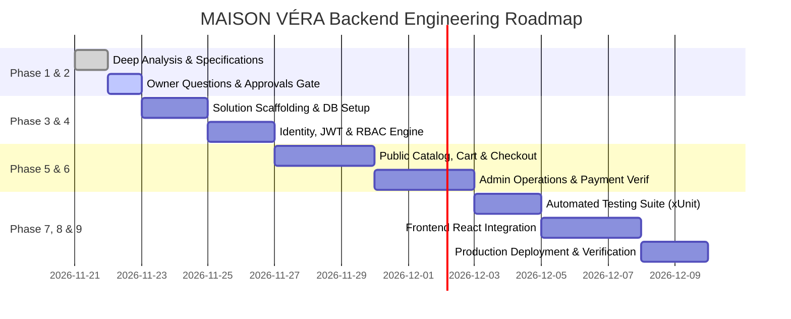

# MAISON VÉRA — Backend Implementation Roadmap & Plan
**Phased Engineering Blueprint for ASP.NET Core 8 & Supabase PostgreSQL**
*Document Version: 1.0.0 | Date: 2026-11-21 | Target Solution: Clean Architecture .NET 8*

---

## 1. Clean Architecture Solution Blueprint

The backend solution adheres to **Clean Architecture** (Onion / Hexagonal Architecture) principles, enforcing strict separation of concerns, domain-driven design, and testability.

```
ClothingStore/ (or MaisonVera.sln)
├── src/
│   ├── ClothingStore.Domain/                # Pure C# Domain Layer (Zero External Dependencies)
│   │   ├── Common/                         # BaseEntity, AuditableEntity, ValueObject, AggregateRoot
│   │   ├── Entities/                       # Product, Order, OrderItem, CustomerAddress, User, Role, etc.
│   │   ├── Enums/                          # OrderStatus, PaymentStatus, GenderCollection, PaymentMethod
│   │   ├── Exceptions/                     # DomainException, InsufficientStockException, InvalidCouponException
│   │   └── Events/                         # OrderPlacedEvent, PaymentVerifiedEvent, LowStockEvent
│   │
│   ├── ClothingStore.Application/           # Use Cases & Application Business Logic
│   │   ├── Common/
│   │   │   ├── Interfaces/                 # IApplicationDbContext, ICurrentUserService, IJwtService, IFileStorage
│   │   │   ├── Models/                     # PaginatedList<T>, Result<T>, EnvelopeResponse<T>
│   │   │   └── Behaviors/                  # ValidationBehavior, LoggingBehavior, PerformanceBehavior
│   │   ├── Features/
│   │   │   ├── Auth/                       # RegisterCommand, LoginQuery, RefreshTokenCommand
│   │   │   ├── Products/                   # GetProductsQuery, GetProductBySlugQuery, CreateProductCommand
│   │   │   ├── Orders/                     # CheckoutCommand, GetOrderByIdQuery, UpdateOrderStatusCommand
│   │   │   ├── Payments/                   # VerifyPaymentCommand, UploadProofCommand
│   │   │   └── Inventory/                  # AdjustStockCommand, GetLowStockQuery
│   │   └── Validators/                     # FluentValidation rules for all commands and queries
│   │
│   ├── ClothingStore.Infrastructure/        # External Frameworks, DB & Third-Party Adapters
│   │   ├── Persistence/
│   │   │   ├── MaisonVeraDbContext.cs      # EF Core DbContext with Npgsql provider
│   │   │   ├── Configurations/             # Fluent API entity configurations (IEntityTypeConfiguration<T>)
│   │   │   ├── Interceptors/               # AuditableEntityInterceptor, AuditLogInterceptor
│   │   │   └── Migrations/                 # EF Core Code-First migration snapshots
│   │   ├── Identity/                       # Custom PasswordHasher (Argon2id), IdentityService
│   │   ├── Services/                       # JwtService, NepalDeliveryTariffCalculator, CouponService
│   │   └── Storage/                        # SupabaseStorageService (S3-compatible bucket client)
│   │
│   └── ClothingStore.Api/                   # Presentation Layer (ASP.NET Core 8 Web API)
│       ├── Controllers/                    # AuthController, ProductsController, OrdersController, AdminController
│       ├── Middleware/                     # ExceptionHandlingMiddleware, SecurityHeadersMiddleware, RateLimiting
│       ├── Filters/                        # ApiExceptionFilterAttribute
│       ├── Extensions/                     # ServiceCollectionExtensions, SwaggerExtensions
│       ├── Program.cs                      # Application composition root
│       └── appsettings.json                # Configuration templates
│
└── tests/
    ├── ClothingStore.UnitTests/             # Domain logic, calculation engines & validator tests
    └── ClothingStore.IntegrationTests/      # WebApplicationFactory API & database integration tests
```

---

## 2. Phased Engineering Roadmap



---

## 3. Detailed Work Breakdown by Phase

### Phase 1: Deep Analysis & Architectural Artifacts (Complete)
- **Status:** **Completed**
- **Deliverables:**
  - `docs/PROJECT_ANALYSIS.md` (Audit of all 62 routes, mock storage mappings, and Nepal geography).
  - `docs/DATABASE_DESIGN.md` (28 PostgreSQL tables, UUID keys, decimal precision, indexes, ERD).
  - `docs/API_SPECIFICATION.md` (Standard envelope, RFC 7807 error format, and endpoint directory).
  - `docs/AUTHENTICATION_SECURITY.md` (Argon2id hashing, JWT rotation, HttpOnly cookies, RBAC).
  - `docs/IMPLEMENTATION_PLAN.md` (This document).
  - `docs/TESTING_PLAN.md` (Unit, integration, and security test matrix).
  - `docs/QUESTIONS_FOR_OWNER.md` (Design and credential decisions required from owner).

---

### Phase 2: Questions for the Owner & Approvals Gate
- **Status:** **Current Gate**
- **Objective:** Present analysis and structured decision questions to the store owner.
- **Criteria for Exit:** Explicit confirmation and provision of credentials/decisions from the user.

---

### Phase 3: Solution Scaffolding & Database Setup
- **Tasks:**
  1. Scaffold .NET 8 solution with Clean Architecture folder structure (`Domain`, `Application`, `Infrastructure`, `Api`, `UnitTests`, `IntegrationTests`).
  2. Install core NuGet dependencies:
     - `Npgsql.EntityFrameworkCore.PostgreSQL: 8.0.*`
     - `Microsoft.EntityFrameworkCore.Design: 8.0.*`
     - `FluentValidation.AspNetCore: 11.3.*`
     - `MediatR: 12.4.*`
     - `Serilog.AspNetCore: 8.0.*`
     - `Swashbuckle.AspNetCore: 6.5.*`
     - `Konscious.Security.Cryptography.Argon2: 1.3.*`
  3. Implement entity models with strongly-typed configurations in `ClothingStore.Infrastructure.Persistence.Configurations`.
  4. Configure database connection to Supabase PostgreSQL (Direct port 5432 or Transaction pooler port 6543).
  5. Generate initial EF Core Code-First migration: `dotnet ef migrations add InitialMaisonVeraDb`.
  6. Execute migration to provision schema on Supabase: `dotnet ef database update`.
  7. Seed essential reference data: Roles (`Super Admin`, `Admin`, `Product Manager`, etc.), Admin user, Delivery Zones for Nepal, Default Brand and Payment settings.
- **Dependencies:** Owner's Supabase connection string.
- **Acceptance Criteria:** `dotnet ef database update` succeeds with zero errors, and all 28 tables are visible in Supabase Table Editor.

---

### Phase 4: Core Services, Authentication & RBAC Engine
- **Tasks:**
  1. Implement `PasswordHasher` utilizing Argon2id with 64MB memory cost.
  2. Implement `JwtService` generating access tokens with custom claims (`sub`, `email`, `role`, `user_type`).
  3. Implement `RefreshTokenService` with database hashing, expiration validation, automatic rotation, and token reuse breach detection.
  4. Create `AuthController` handling `Register`, `Login`, `RefreshToken`, `Logout`, `ForgotPassword`, and `ResetPassword`.
  5. Implement `CustomAuthorizationHandler` enforcing the Module Permission Matrix.
  6. Configure ASP.NET Core 8 Rate Limiter (5 attempts/min for login).
- **Acceptance Criteria:** Full authentication flow passes via Swagger; refresh token rotates safely; token reuse invalidates all sessions.

---

### Phase 5: Business Domain Implementation (Catalog, Cart, Orders & Nepal Checkout)
- **Tasks:**
  1. Implement Public Product Catalog queries with multi-faceted filtering, searching, and sorting.
  2. Implement `ProductDetailPage` queries returning live variant stock matrices.
  3. Implement Server-Side Bag (Cart) synchronization with optimistic stock locking.
  4. Implement Nepal Delivery Tariff calculation engine (`NepalDeliveryTariffService`) using federal provinces and districts.
  5. Implement Coupon validation and discount application logic (Percentage vs Fixed, minimum spend).
  6. Implement atomic Checkout transaction (`CheckoutCommand`):
     - Validates line items and active variant stock.
     - Decrements inventory atomically.
     - Generates sequential order number (`MV-2026-XXXX`).
     - Freezes physical shipping address and item price snapshots.
     - Appends initial timeline event: `Placed`.
  7. Implement payment receipt screenshot upload to Supabase Storage with MIME/magic-byte validation.
- **Acceptance Criteria:** A guest or client can complete checkout; stock is accurately decremented; order receipt is produced.

---

### Phase 6: Admin Operations & Payment Verification
- **Tasks:**
  1. Implement Executive Dashboard metrics aggregation query (Revenue, Orders, Low Stock, Customers).
  2. Implement Order Fulfillment state machine endpoint (`PATCH /api/v1/admin/orders/{id}/status`) ensuring valid state transitions.
  3. Implement Payment Operations Portal:
     - `GET /api/v1/admin/payments` (Listing digital wallet receipts awaiting verification).
     - `POST /api/v1/admin/payments/{id}/verify` (Approves payment, updates status to `Verified`, confirms order).
     - `POST /api/v1/admin/payments/{id}/reject` (Rejects payment with mandatory reason, releases stock, alerts customer).
  4. Implement Multi-variant Inventory stock adjustment with audit logging.
  5. Implement Staff provisioning and role assignment.
  6. Implement immutable Audit Logging interceptor for all administrative mutations.
- **Acceptance Criteria:** Administrative actions advance order state; payment approval commits orders; audit logs capture every mutation.

---

### Phase 7: Automated Testing & Quality Assurance
- **Tasks:**
  1. Build xUnit unit test suite in `ClothingStore.UnitTests` covering domain entities, tariff calculator, coupon calculations, and validators.
  2. Build integration test suite in `ClothingStore.IntegrationTests` using `WebApplicationFactory<Program>` testing end-to-end API workflows.
  3. Perform security tests (unauthorized access, role escalation, token tampering, rate-limit tripping).
- **Acceptance Criteria:** 100% of automated tests pass without warnings.

---

### Phase 8: Frontend Integration (React 19 + TypeScript)
- **Tasks:**
  1. Create typed HTTP client in `src/services/api/` with Axios/Fetch and automatic token refresh interceptor.
  2. Create API client services: `authService`, `productService`, `orderService`, `paymentService`, `adminService`.
  3. Refactor `StoreContext.tsx` to hydrate state asynchronously from API endpoints rather than static `localStorage`.
  4. Wire file upload in `CheckoutPage` and `AdminProductFormPage` to multipart upload endpoints.
  5. Bind API validation errors to frontend UI components and toast notifications.
- **Acceptance Criteria:** The entire existing UI functions seamlessly against live backend endpoints; zero layout alterations.

---

### Phase 9: Deployment & Verification
- **Tasks:**
  1. Apply final production database migrations on Supabase.
  2. Deploy ASP.NET Core 8 API to chosen cloud host (Azure App Service / Railway / Render).
  3. Configure production CORS, SSL/TLS certificates, and environment secrets.
  4. Update Vercel/GitHub Pages frontend environment variables (`VITE_API_BASE_URL`).
  5. Run complete smoke test suite verifying end-to-end order placement and administrative fulfillment.
- **Acceptance Criteria:** Live public URL successfully processes orders; administrative dashboard operates with real-time database persistence.
